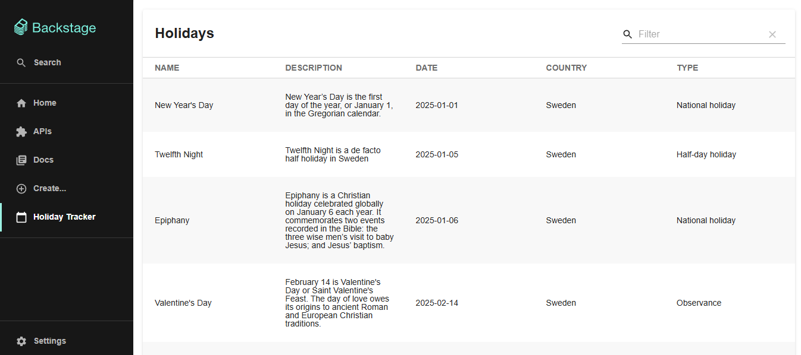

# Holiday Tracker Plugin for Backstage

The Holiday Tracker Plugin for Backstage provides a convenient way to display and manage holiday information for any specified country or region using the Calendarific API. This plugin includes a secure backend proxy configuration to fetch holiday data without exposing your API key.

---

## Installation

To install the plugin, run the following command:

```bash
yarn --cwd packages/app add @infosys_ltd/holiday-tracker-plugin
```

After installation, create an account on [Calendarific](https://calendarific.com/) and generate your API Access Key.

---

## Configuration

### Backend Proxy Configuration

Update your `app-config.yaml` file with the following proxy configuration:

```yaml
proxy:
  endpoints:
    '/holidays':
      target: 'https://calendarific.com/api/v2/holidays?api_key=YOUR_API_KEY&country=YOUR_DEFAULT_LOCATION&year=YOUR_HOLIDAY_YEAR'
      changeOrigin: true
```

**Important Notes:**

- Replace `YOUR_API_KEY` with your Calendarific API key.
- Replace `YOUR_DEFAULT_LOCATION` with the desired default location (e.g., `IN`).
- Replace `YOUR_HOLIDAY_YEAR` with the desired year (e.g., `2025`).

This configuration ensures:

- The `api_key` (API key) is securely embedded in the proxy target URL.
- The `country` parameter specifies the default location for calendar data.
- The `year` parameter specifies the year for calendar data.

---

## Using Environment Variables (Optional)

Instead of hardcoding the `api_key`,`country`,`year` in the configuration file, you can dynamically set them via environment variables. This approach is more secure and flexible.

Set the following environment variables in your CLI:

```bash
export HOLIDAY_TRACKER_ACCESS_KEY=your_api_key_here
export HOLIDAY_TRACKER_LOCATION=your_default_location_here
export HOLIDAY_TRACKER_YEAR=your_default_year_here
```

Then update the `app-config.yaml` as follows:

```yaml
proxy:
  endpoints:
    '/holidays':
      target: 'https://calendarific.com/api/v2/holidays?api_key=${HOLIDAY_TRACKER_ACCESS_KEY}&country=${HOLIDAY_TRACKER_LOCATION}&year=${HOLIDAY_TRACKER_YEAR}'
      changeOrigin: true
```

---

## Usage

### New frontend system (recommended)

The plugin is the default export of the package. If your app uses feature discovery
(`app.packages: all` in `app-config.yaml`), installing the package is enough. Otherwise
register it explicitly in `packages/app/src/App.tsx`:

```tsx
import { createApp } from '@backstage/frontend-defaults';
import holidayTrackerPlugin from '@infosys_ltd/holiday-tracker-plugin';

const app = createApp({
  features: [holidayTrackerPlugin],
});

export default app.createRoot();
```

The plugin provides:

| Extension              | Description                                                           |
| ---------------------- | --------------------------------------------------------------------- |
| `api:holiday-tracker`  | The `holidayApiRef` implementation, backed by the Backstage proxy     |
| `page:holiday-tracker` | The holiday table page, mounted at `/holiday-tracker` with a nav item |

You can change the page path through config:

```yaml
app:
  extensions:
    - page:holiday-tracker:
        config:
          path: /holidays
```

### Legacy frontend system

```tsx
import { HolidayTrackerPage } from '@infosys_ltd/holiday-tracker-plugin';

// packages/app/src/App.tsx
<Route path="/holiday-tracker" element={<HolidayTrackerPage />} />;
```

---

### Example Screenshots



---

## Contributing

Contributions are welcome! Please open an issue or submit a pull request for any improvements or bug fixes.

---

## License

This project is licensed under the Apache License 2.0. See the [LICENSE](https://github.com/Infosys/holiday-tracker-plugin/blob/main/LICENSE) file for details.
